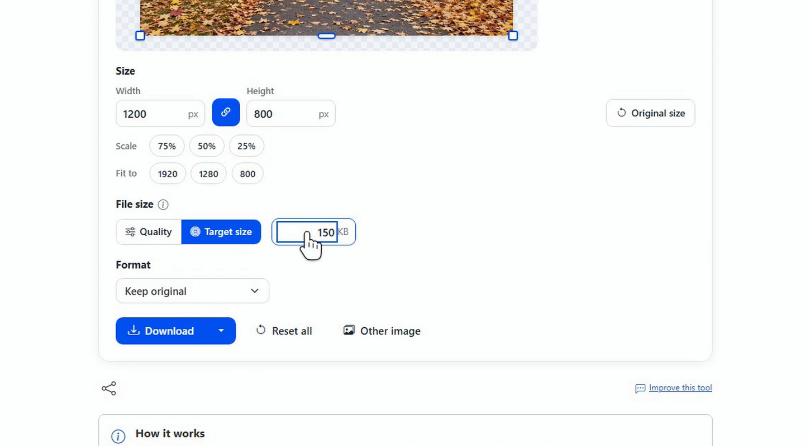

# Photo export size budget

Check whether an exported photo fits the upload limit in the brief. Give the script a file and a limit in KiB. It compares the actual byte count and exits with 1 when the file exceeds the limit.

```console
npm test
node scripts/size-budget.js example/autumn-park-1200.jpg 150
```

One KiB is 1024 bytes. If a form lists a decimal KB limit, convert that limit before comparing. The bundled image was exported at 1200 × 800 in the resize tutorial. The screenshot shows the live resize workflow.



## Try it here

- [Image resizer](https://toolster.net/resize_photo) to change dimensions or target size.
- [Photo cropper](https://toolster.net/cut_photo) to remove unused areas before exporting.
- [Photo editor](https://toolster.net/photo_editor) for edits before export.

The size checker is written independently and provided under the MIT license.
